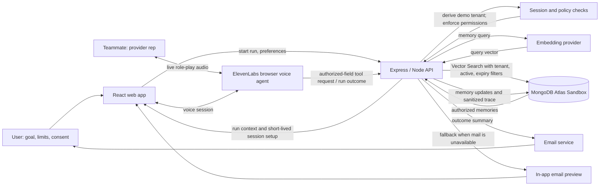

# CallE Hackathon Design

## Intent

Build a time-boxed, voice-first demo of CallE, an AI agent that negotiates a
service offer on a user's behalf. The demo should show governed memory changing
what the agent says in a later negotiation, rather than merely presenting stored
memory as background context.

## Users and demo

Use synthetic account data. A teammate plays the service representative in a
live browser-based voice conversation with CallE. CallE identifies itself as an
AI agent authorized to negotiate for the fictional customer. This is a
simulation, not an outbound call to a real provider.

The happy path: seed an active prior offer for Tenant A; start a fresh run and
show Atlas Vector Search retrieves it; run a negotiation and show how it
changes CallE's concrete offer strategy and reaches a successful deal. The
teammate playing the rep accepts a preauthorized synthetic phone number or DOB
for verification. Repeat the same scenario with memory disabled as a control.
Show Tenant B cannot retrieve Tenant A's memory. Correct or expire the original
memory, start another fresh run, and show that the superseding memory changes
behavior or the expired memory is no longer retrieved.

Each trace records the run ID, tenant, retrieved memory IDs, whether memory was
enabled, and the negotiation outcome/action, so the demo ties a persisted
retrieval to an observable behavior change rather than merely showing content
in the prompt.

## Workflow overview

1. **Set up the request:** The user selects a demo tenant, states a goal and
   limits for the negotiation, chooses an email recipient, and optionally
   preauthorizes phone number and DOB for this provider and call. SIN and full
   card number are never available as permission choices.
2. **Prepare the run:** The server derives the tenant from the demo session,
   retrieves only authorized, active, unexpired memories from Atlas Vector
   Search, and records the retrieved memory IDs for the trace.
3. **Negotiate live:** CallE identifies itself as an AI agent and speaks with
   the teammate playing the provider rep. It uses retrieved memory to shape a
   concrete negotiation strategy while staying within the user's limits.
4. **Handle identity requests:** CallE shares phone/DOB only when explicitly
   preauthorized for this call. It refuses SIN/full-card requests and seeks an
   alternate verification method. In the happy path, the rep accepts the
   preauthorized synthetic phone/DOB and negotiation continues. If the rep
   insists on SIN/card details, CallE pauses or hands off; this is a brief
   fallback branch, not the main demo outcome.
5. **Close and notify:** The app records the outcome and behavior trace without
   saving verification values. It sends a concise result email, or shows an
   email preview if mail delivery is not configured.
6. **Govern future memory:** The user reviews and can correct or forget
   relevant memories. Corrections supersede old versions; forgetting deletes
   the memory and embedding. Expiry is enforced on the next retrieval.

For the judging walkthrough, repeat the same scenario with memory enabled and
disabled, test that a second tenant is denied access, then correct or expire a
memory and run again to show the changed behavior.

## Goals

- Use the MERN stack, the hackathon MongoDB Atlas Sandbox, Atlas Vector Search,
  and ElevenLabs live voice.
- Persist tenant-scoped memories with owner/access scope, source,
  status/version, and expiry.
- Apply tenant, authorization, status, and freshness filters in the
  server-side retrieval path and Vector Search pre-filter; never trust the
  agent prompt to enforce access.
- Enforce expiry on every retrieval; use TTL cleanup only as housekeeping.
- Correct a memory by creating a sourced replacement and marking the old
  version superseded. Forget a memory by deleting its record and embedding.
- Show an auditable trace linking retrieved memory IDs to the negotiation
  response, plus a controlled run with memory disabled for comparison.
- Send the requesting user a concise outcome email after the negotiation; use
  an in-app email preview if a sending service cannot be configured in time.
- Let users preauthorize phone number and date of birth for a specific provider
  and call. Never offer SIN or full card number as authorizable fields.
- Deliver a reliable end-to-end demo within approximately 4.5 hours for a
  two-person team, accessible at a hosted URL for judges.

## Non-goals and safety boundaries

- No real outbound calls, impersonation, or fabricated competitor offers.
- No real customer data in the hackathon demo; use synthetic phone/DOB values.
- Never collect or disclose a SIN or full payment card number. If asked, CallE
  refuses and requests an alternate verification path or pauses for the user.
- Phone/DOB sharing is denied unless explicitly authorized for the current
  provider and call. Keep these values outside vector memory, negotiation
  traces, transcripts, logs, and notification emails.
- No automatic contract acceptance, cancellation, or other binding action.
- No production authentication, provider integration, or generalized memory
  administration beyond what is necessary to demonstrate the core behavior.

## Approaches considered

1. **Live browser voice with a human acting as the rep (chosen):** keeps the
   conversation interactive and repeatable without telephony setup.
2. **Two AI agents roleplaying both sides:** more automated, but adds complexity
   and makes behavior harder to control or explain.
3. **Real outbound provider call:** closest to a deployed product, but
   telephony is not configured and creates avoidable policy and demo risks.

## Proposed implementation shape

- React UI for starting the role-play, selecting the demo user, reviewing and
  correcting memories, setting call-scoped phone/DOB permissions, and
  inspecting the behavior trace.
- Express/Node API as the trusted boundary for identity/tenant scope, memory
  retrieval, updates, expiry checks, and trace persistence. Derive tenant scope
  from the authenticated or fixed demo session, not a client-supplied tenant ID.
- Deploy the React and Node application to a hosted URL; reserve time to verify
  the deployed app and its server-side environment configuration.
- Atlas collections for memories and negotiation runs; Vector Search over
  memory embeddings with user/tenant, active-status, and expiry constraints.
- ElevenLabs browser voice integration for CallE. The service representative
  is played by a teammate. Keep the LLM/embedding provider choice to the
  simplest provider the team can provision and test.
- Email a minimal call outcome (success/failure, negotiated terms, and date) to
  the requesting user. Do not include personal verification fields, sensitive
  details, audio, or a full transcript. Configure a mail API only if it can be
  provisioned quickly; otherwise show a clearly labeled email preview.
- Use a small, deterministic synthetic scenario so memory-on and memory-off
  runs can be compared consistently.

## High-level architecture

**Request flow:** React starts a run; Express derives the tenant from the
server-side demo session, embeds the query, and retrieves only active,
unexpired memories allowed for that tenant. The browser then opens the
ElevenLabs voice session. The agent can request a call-scoped phone/DOB only
through an Express policy-checked tool; it cannot access Atlas directly.

**Completion flow:** Express stores the run trace and any user-approved memory
change in Atlas, then sends a minimal outcome email or returns an email preview.
Atlas and provider credentials remain server-side. The diagram's profile
permissions and verification values use synthetic demo data only.

**2.5–3-hour MVP boundary:** prioritize the tenant-filtered Vector Search path,
memory correction/expiry, a successful live role-play, and the memory-on/off
behavior trace. Keep the rep human-played and the tenant identities fixed for
the demo. Actual email delivery is a stretch behind the preview fallback; do
not build outbound telephony, a second AI rep, or production authentication.

## Constraints and open implementation choices

The repository is nearly empty. The team has Atlas Sandbox access and an
ElevenLabs account/key; the Atlas connection URI still needs to be configured
for development and hosting. An embedding API key can be obtained. Keep
credentials in local/hosting environment variables, never in the public
repository. A recipient email address is available, but a mail-sending service
is not yet configured. The finalist build must use the hackathon Atlas Sandbox,
and the repository must be public.
Exact model/provider, minimal UI, memory schema, and agent-tool wiring are
implementation choices, provided they preserve the goals and boundaries above.
The hosting platform is also a builder choice, favoring a quick deployment
compatible with the app and secret environment variables.
